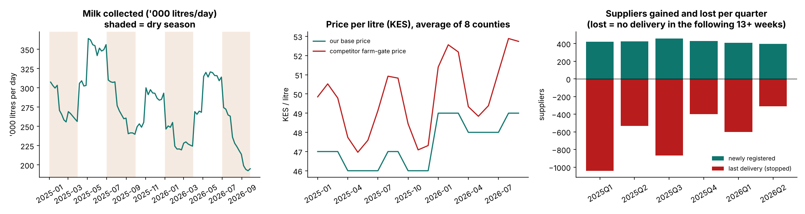
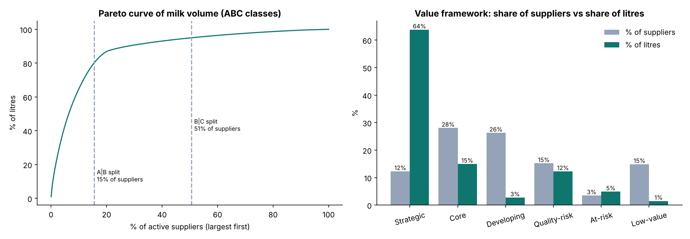
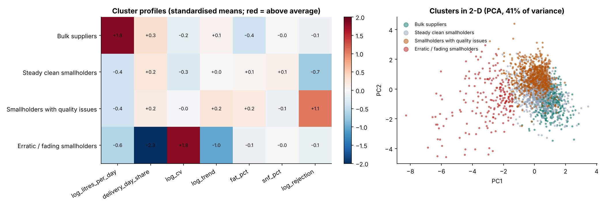
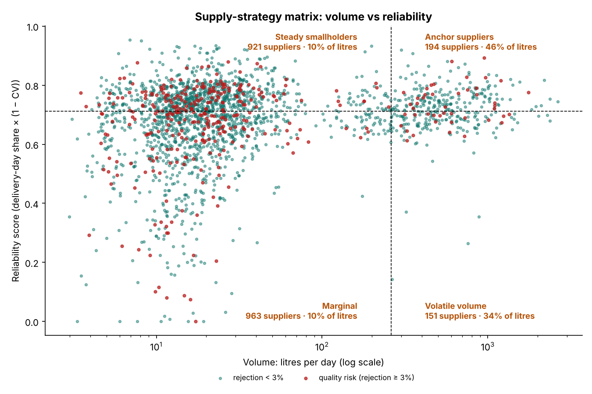
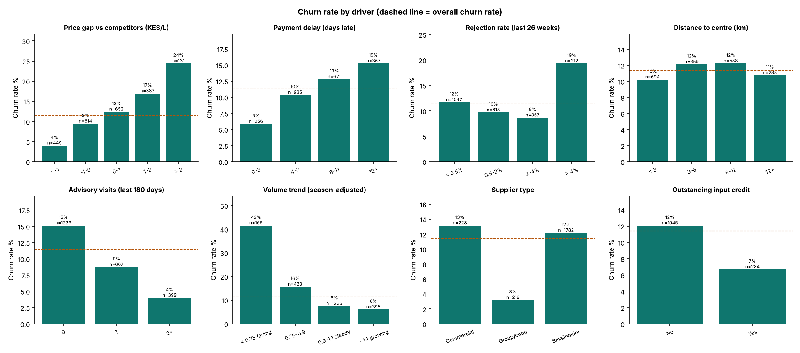
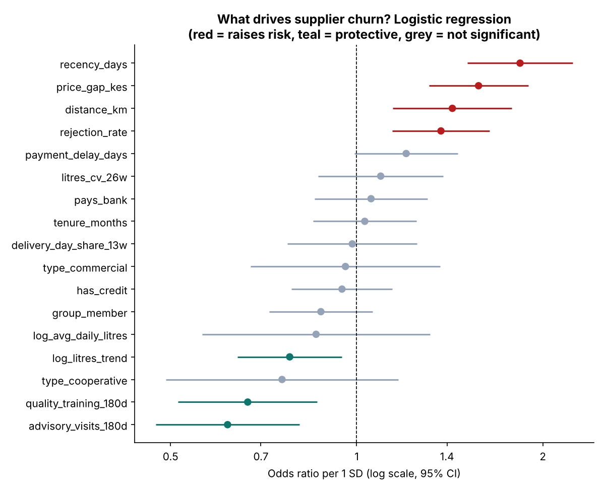
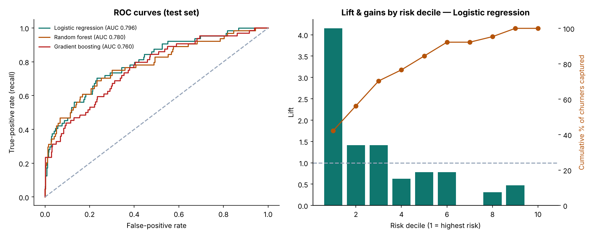
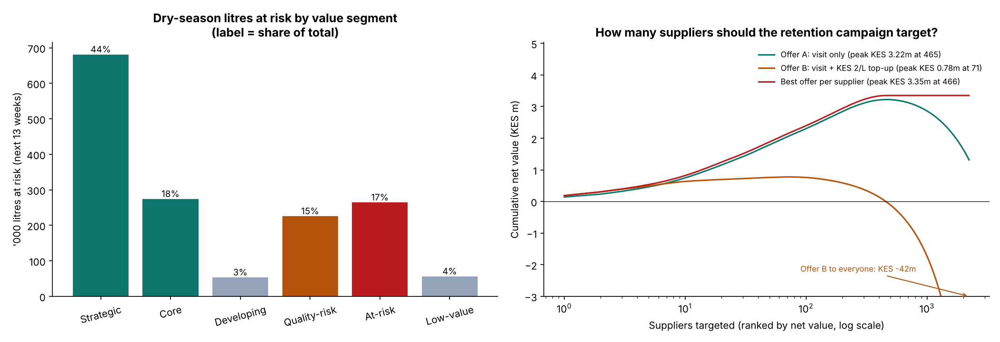

# Supplier Segmentation & Churn Analysis — which milk suppliers matter most, and which are about to side-sell?

An end-to-end analysis of the **milk-supplier base of a Kenyan dairy processor**: smallholder farmers, farmer groups / cooperatives and commercial farms delivering raw milk to **10 collection centres in 8 counties**.

1. **Segmentation:** a supplier value framework (ABC volume × reliability × quality × trend), K-means clustering and a 2 × 2 supply-strategy matrix, to show who carries the supply and what each group needs.
2. **Churn prediction:** a leakage-safe model of suppliers who **stop delivering** (usually side-selling to competing processors or brokers), to find who is about to leave, why, how many **dry-season litres** are at risk and what it's worth spending to keep them.

Built in **Python** and rebuilt independently from the raw files in **base R**. The two implementations agree on every feature (max difference 5 × 10⁻⁹), every logistic-regression coefficient (max difference 2.8 × 10⁻¹⁵), the same test AUC (0.796), and 100% of segment and cluster assignments.

> **Data note:** all data is **synthetic**, generated by [`data/generate_data.py`](data/generate_data.py): 6,000 registered suppliers (about 2,200 active at the snapshot), 219k supplier-weeks of deliveries (175m litres), 52k monthly payments, competitor prices by county and month, extension visits and input-credit advances, January 2025 – September 2026. Hidden drivers (competitor price gap, payment delays, rejections, distance, extension coverage, credit, group membership, an unobserved loyalty trait) shape behaviour, but only observable ERP-style records are exported. No real company, farmer or price data is used.

| | |
|---|---|
| 📓 **Full walkthrough, every step explained** | [`python/supplier_segmentation_churn.ipynb`](python/supplier_segmentation_churn.ipynb) |
| 📊 **R rebuild + results report** | [`R/supplier_segmentation_churn.R`](R/supplier_segmentation_churn.R) → [`outputs/r/R_results.md`](outputs/r/R_results.md) |
| 🧑‍🌾 **Ranked supplier action list** | [`outputs/python/churn_risk_scores.csv`](outputs/python/churn_risk_scores.csv) |

---

## 1. Why do this analysis?

| Question | Why it matters for a dairy processor |
|---|---|
| **Who are our suppliers?** | A 3-litre smallholder and a 2,000-litre cooperative need completely different relationships. One service model for everyone wastes field time and under-serves the suppliers that fill the plant. |
| **Who is about to stop delivering?** | Farmers don't cancel; they **side-sell**, first part of their milk and then all of it. That fade leaves a window to act. |
| **When does it hurt most?** | In the **dry season** (Jan–Mar, Jul–Sep) milk is scarce and competitors bid prices up. A litre lost in August is far harder to replace than a litre lost in May. |
| **Which losses matter?** | Retention budgets should follow **litres at risk**, not headcount. |



Intake swings from about **364,000 L/day** in the peak flush week to about **192,000** in the lowest dry-season week. Competitors pay on average **KES 1.4/L above our base price in flush months and KES 3.3/L above it in dry months**.

---

## 2. Method

```
deliveries (weekly) + payments + competitor prices + visits + input credit + supplier attributes
   └─► snapshot 28-Jun-2026 (end of the flush): features from the PAST only (no leakage)
         ├─► PART A  Segmentation (2,229 active suppliers)
         │      value framework: ABC volume classes (80/15/5% of litres) × reliability × quality × fading → 6 segments
         │      K-means on 7 log-scaled / standardised behaviours (k = 4) → clusters named from their profiles
         │      2 × 2 supply-strategy matrix: volume × reliability, quality risk highlighted
         └─► PART B  Churn:  label = active supplier with NO delivery from day 29 to day 91 after the snapshot
                              (stops within ~4 weeks, then silent ≥ 63 days through the dry season)
                              logistic regression · random forest · gradient boosting
                              deterministic 75/25 split (same split in Python and R)
                              ROC-AUC · PR-AUC · Brier · gains/lift · odds ratios · permutation importance
                              → dry-season litres at risk by segment → retention-offer economics
```

**Why a 4-week grace period?** Leavers usually fade before they stop. Requiring zero deliveries from day 1 would label a supplier who is visibly fading as "retained". **Why 63 silent days?** Small herds pause for a few weeks when a cow dries off; 9 silent weeks separates real churn from those pauses.

**Features:** volume (litres/day), delivery-day share, weekly CV, **season-adjusted trend** (supplier's last-8-week vs prior-18-week ratio ÷ the same ratio for its centre), fat / SNF, rejection rate and reasons, **realised price vs the competitor farm-gate price** in the supplier's county, **payment delay** (only payments actually paid by the snapshot), distance, extension / vet visits, quality-training visits, outstanding input credit, tenure, group membership, payment method and supplier type.

---

## 3. Segmentation results

### Who supplies the milk

| Supplier type | Active suppliers | Share of suppliers | Share of litres |
|---|---:|---:|---:|
| Smallholder | 1,782 | 80% | **13%** |
| Farmer group / cooperative | 219 | 10% | **48%** |
| Commercial farm | 228 | 10% | **39%** |

Just **345 suppliers (15%)** deliver 80% of the milk (ABC class A), and every one of them is a cooperative or commercial farm.

### The supplier value framework

| Segment | Rule (in order) | Suppliers | % of suppliers | % of litres | Strategy |
|---|---|---:|---:|---:|---|
| **Strategic** | Class A, reliable | 273 | 12% | **64%** | Protect: key-account management |
| **Core** | Other class A, or class B | 625 | 28% | 15% | Stabilise and grow |
| **Developing** | Class C, reliable | 585 | 26% | 3% | Grow yield: extension, AI, feed credit |
| **Quality-risk** | Rejection rate ≥ 3% | 338 | 15% | 12% | Quality training + follow-up (includes 43 bulk suppliers) |
| **At-risk** | Fading, class A/B | 77 | 3.5% | 5% | Visit within a week |
| **Low-value** | Class C, erratic | 331 | 15% | 1.5% | Lowest-cost service |



### K-means: four behavioural clusters (k = 4)

| Cluster | Suppliers | Litres share | Profile |
|---|---:|---:|---|
| **Bulk suppliers** | 430 | **85%** | Cooperatives and commercial farms; median 444 L/day; deliver on 93% of days |
| **Steady clean smallholders** | 909 | 7% | Median 18 L/day; 0.2% rejections |
| **Smallholders with quality issues** | 690 | 6% | Same size and consistency, but 3.1% rejections |
| **Erratic / fading smallholders** | 200 | 2% | Deliver on 70% of days; weekly CV 0.43; trend 0.78 (includes 5 fading commercial farms) |



Silhouette is highest at k = 2 (0.27), but that split is just bulk vs smallholder, which the supplier type already tells us. k = 4 is the last k before the silhouette plateau (0.167 vs 0.166 at k = 5), and each of the four clusters needs a different action. The modest silhouette means the clusters overlap: supplier behaviour is a continuum. **272 of the 273 Strategic suppliers fall in the Bulk cluster**, so the rule-based framework and the algorithm agree on who the backbone is.

### Supply-strategy matrix

| Quadrant | Suppliers | Litres | Strategy |
|---|---:|---:|---|
| **Anchor suppliers** (high volume, high reliability) | 194 | **46%** | Protect |
| **Volatile volume** (high volume, lower reliability) | 151 | **34%** | Secure: supply agreements |
| **Steady smallholders** | 921 | 10% | Develop |
| **Marginal** | 963 | 10% | Serve efficiently |



Quality risk appears in **every** quadrant (13–17% of suppliers in each). It has nothing to do with size.

---

## 4. Churn results

**Population:** 2,229 suppliers active at the snapshot · **254 churned (11.4%)**. Together they had been delivering about **21,600 L/day (7.8% of volume)**.
**Commercial farms churn as often as smallholders** (13.2% vs 12.2%) and account for **62% of the litres lost**. Cooperatives churn at 3.2%.

### What drives churn?



| Driver | Churn rate |
|---|---|
| Competitors pay > KES 2/L more vs we pay > KES 1/L more | **24%** vs 4% |
| Paid 12+ days late vs within 3 days | **15%** vs 6% |
| No advisory visit in 6 months vs 2+ visits | **15%** vs 4% |
| Season-adjusted trend < 0.75 (fading) vs steady | **42%** vs 8% |
| Rejection rate > 4% vs 0.5–4% | **19%** vs 9–10% |

**Two confounding lessons:**

* **Rejection rate is U-shaped.** The cleanest band (< 0.5%) is dominated by newer suppliers (median tenure 10.9 months), who have had fewer chances to be rejected and churn more for other reasons. This is an **exposure effect**.
* **Distance looks flat**, because 78% of the 12+ km suppliers are bulk suppliers with volume bonuses and their own transport. Once these are controlled for, distance is a significant risk factor (below).

### Logistic regression: independent effects (odds ratio per 1 SD)



- **Risk:** recency (**1.84** per 3 days, i.e. missing a week), **price gap (1.57** per KES 1.25/L), distance (**1.43** per 5.8 km), rejection rate (**1.37** per 2 pp)
- **Protective:** advisory visits (**0.62** per visit), quality training (**0.67**, protective once rejections are held constant), volume trend (**0.78**)
- **Borderline:** payment delay (1.20 per 3.7 days, 95% CI 0.99–1.46, p = 0.06)
- **Not significant once these are controlled for:** input credit (0.95), group membership (0.88), supplier type, tenure, payment method. Credit and group membership look protective in the raw data, but their holders also get more visits and better terms. With about 190 training churners the model can't separate those effects. Not significant means **not proven**, not **no effect**.

### Model performance (held-out test set, 541 suppliers, 64 churners)

| Model | ROC-AUC | PR-AUC | Brier |
|---|---:|---:|---:|
| **Logistic regression** | **0.796** | 0.465 | 0.084 |
| Random forest | 0.780 | **0.475** | **0.083** |
| Gradient boosting | 0.760 | 0.429 | 0.085 |
| No model (baseline) | 0.500 | 0.118 | 0.104 |

The explainable logistic regression ranks best. **The riskiest 10% of suppliers contain 42% of future churners (lift 4.2×), and the top 20% contain 56%.** Permutation importance on the gradient-boosting model confirms the story: price gap first, then recency and volume trend.



---

## 5. Dry-season litres at risk and retention economics

Expected litres over the next 13 weeks = recent weekly litres × 13 × a **dry-season factor of 0.84**, estimated from Jul–Sep 2025. The model puts **1.55m of 23.9m litres (6.5%)** at risk; the suppliers who actually churned would have delivered 1.69m (7.1%).

| Value segment | Suppliers | Actual churn | Share of litres at risk |
|---|---:|---:|---:|
| Strategic | 273 | 5.1% | **44%** |
| Core | 625 | 8.0% | 18% |
| At-risk | 77 | **40.3%** | 17% |
| Quality-risk | 338 | 15.4% | 15% |
| Low-value | 331 | 18.7% | 4% |
| Developing | 585 | 7.7% | 3% |

**The lowest-churn segment holds the most litres at risk**, and a simple two-condition "fading" flag picks out 77 suppliers who churned at 40%.



**Retention offers** (illustrative assumptions: a retained dry-season litre is worth KES 12; a field-officer visit costs KES 1,500 and saves 25% of would-be leavers; visit + KES 2/L loyalty top-up saves 40%, with the top-up paid on every litre delivered):

- The best plan targets **466 suppliers**: 415 visits and 51 visit + top-up. It retains about **349,000 litres**, for a net value of about **KES 3.35m** on KES 0.84m spend.
- **A blanket KES 2/L top-up for all suppliers would lose about KES 42m**, because most of it goes to suppliers who would have stayed. Targeted price matching beats across-the-board price rises.
- **Strategic suppliers dominate the plan** (232 targeted) despite the lowest churn rate. For a typical smallholder (21 L/day) a paid visit breaks even only at ≥ 35% churn probability, so smallholders need cheaper channels: group meetings, SMS, and payment alerts.

---

## 6. Recommended actions

| Segment / signal | Action |
|---|---|
| Strategic | Key-account officer, on-time payment, quarterly price review against the local competitor price, priority credit and vet services |
| Core | Supply agreements, extension packages, cooling support where distance sours milk |
| Developing | AI, fodder and feed-credit packages; farmer-group membership |
| Quality-risk | Quality training **plus a follow-up visit after every rejection**; antibiotic withdrawal-period education; strip tests for bulk suppliers |
| At-risk (fading) | Visit within 7 days; find the cause; targeted price match where the expected value supports it |
| Low-value | Group collection, M-Pesa, SMS; no individual field visits |
| Price gap > KES 1/L | Monthly county competitor price survey; targeted quality / volume bonuses before the dry season |
| Payment delays | Pay on the 10th; move bank-paid farmers to faster rails; publish payment dates |

---

## 7. Where supplier segmentation & churn analytics are used

| Sector | Segmentation | Churn / attrition |
|---|---|---|
| Dairy & fresh produce (milk, tea, coffee, horticulture) | Supplier tiering, extension targeting | Side-selling early warning, dry-season retention |
| FMCG manufacturing | Kraljic / ABC supplier portfolios | Supplier exit and single-source risk |
| Out-grower schemes (sugar, tobacco, barley) | Farmer productivity and repayment segments | Contract default, crop diversion |
| Microfinance & SACCOs | Member value segments | Member dormancy and exit |
| Logistics | Transporter scorecards | Losing reliable carriers in peak season |
| Marketplaces | Seller tiers | Seller churn to rival platforms |
| Healthcare supply chains | Vendor performance tiers | Vendor failure risk |
| Gig & field-force platforms | Agent productivity segments | Agent drop-out |

---

## 8. Limitations and next steps

- **Synthetic data:** effect sizes are illustrative. The simulated supplier base also shrinks steeply early in 2025, partly as an artefact of how the simulation starts. On real data, validate on a later snapshot (out-of-time test).
- **Few events:** 254 churners (64 in test), so the AUC carries about ±0.07 uncertainty and weak effects may be under-powered.
- **Prediction ≠ prevention:** the save rates are assumptions. Run a randomised pilot (uplift modelling) before scaling.
- **Partial side-selling:** model litres delivered ÷ estimated herd output to catch partial diversion earlier than full churn.
- **Survival analysis** (Cox) to estimate *when* a supplier will leave, using every snapshot.
- **Monitoring:** rescore monthly, and recheck calibration at the start of each dry season.

---

## 9. Run it

```bash
pip install -r requirements.txt
python data/generate_data.py                                    # optional: regenerate data (seeded, deterministic)
python python/build_notebook.py
jupyter nbconvert --to notebook --execute --inplace python/supplier_segmentation_churn.ipynb
Rscript R/supplier_segmentation_churn.R                         # base R only; run after the notebook for the cross-check
```

```
supplier-segmentation-churn/
├── data/            generate_data.py · suppliers.csv · deliveries_weekly.csv.gz · payments_monthly.csv
│                    market_prices.csv · extension_visits.csv · input_credit.csv
├── python/          features.py (leakage-safe feature engineering) · build_notebook.py · supplier_segmentation_churn.ipynb
├── R/               supplier_segmentation_churn.R (independent rebuild from raw data + cross-check)
└── outputs/         python/ (charts, segments, scores, metrics, features) · r/ (charts, R_results.md)
```

**Stack:** Python · pandas · scikit-learn · statsmodels · matplotlib · R (base, stats, graphics)
