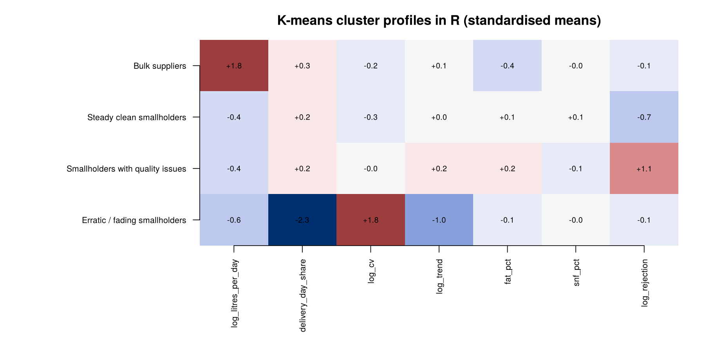
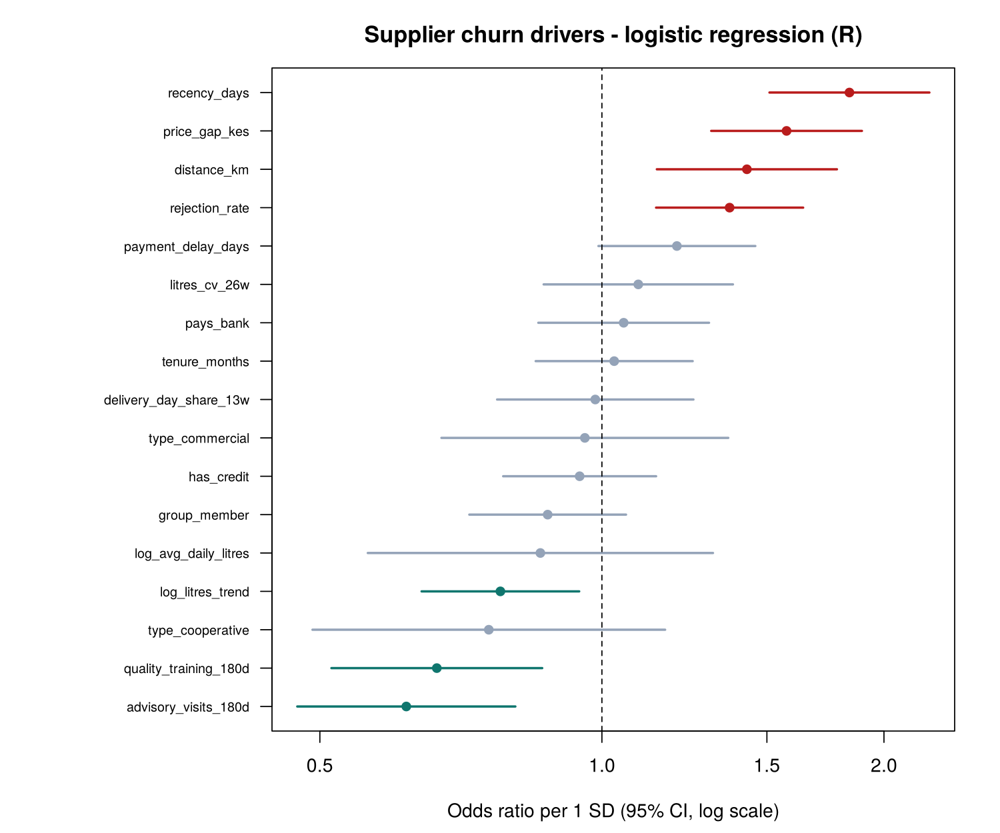
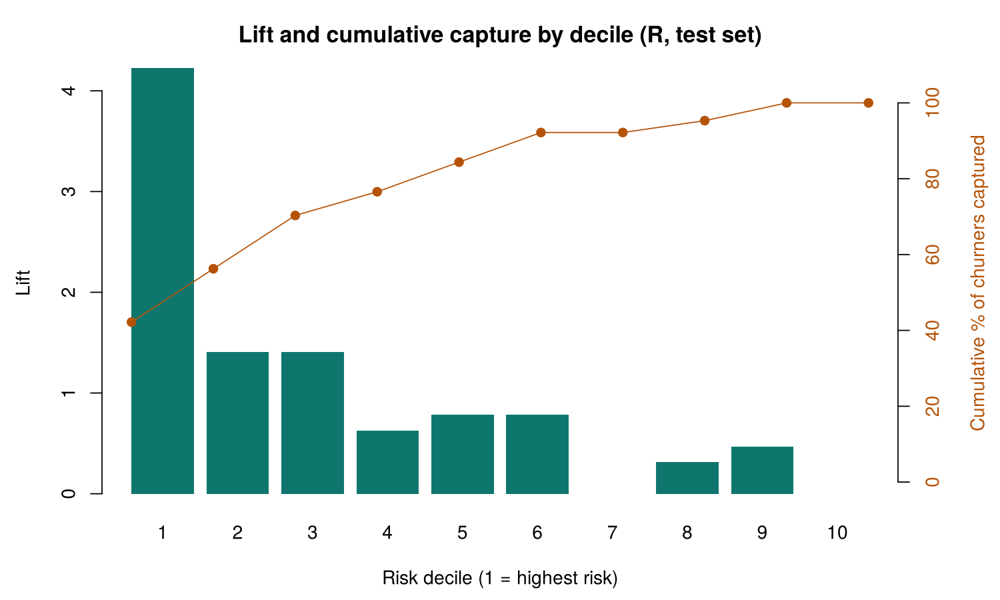

# Supplier Segmentation & Churn — R results (auto-generated by `R/supplier_segmentation_churn.R`)

*Snapshot 2026-06-28 · 2229 active suppliers segmented and modelled · churn = no delivery from day 29 to day 91 after the snapshot*

## Cross-check with the Python notebook

- Suppliers matched: 2229 of 2229 active suppliers; churn labels identical for 100.00%
- Features rebuilt from raw data: largest absolute difference across 21 features = 5.0e-09 (rounding of the exported CSV is 1e-8)
- Logistic regression: 17 coefficients compared, max |coef difference| = 2.8e-15, max relative odds-ratio difference = 2.7e-15
- Value-framework segment agreement: 100.00% | K-means cluster agreement: 100.00%

R's `kmeans()` (Hartigan-Wong, 25 random starts) and scikit-learn (Lloyd, k-means++) use different algorithms and starting points, so a few borderline suppliers can land in a neighbouring cluster; the cluster *profiles* are the same. All other quantities are deterministic and are expected to match to floating-point precision.

## Value framework

| segment | suppliers | litres_share | median_litres_day | rejection_rate |
| --- | --- | --- | --- | --- |
| Strategic | 273 | 63.8% | 530.3 | 0.70% |
| Core | 625 | 14.9% | 31.9 | 0.73% |
| Developing | 585 | 2.7% | 13.1 | 0.72% |
| Quality-risk | 338 | 12.2% | 19.1 | 5.02% |
| At-risk | 77 | 4.9% | 36.1 | 1.54% |
| Low-value | 331 | 1.5% | 12.2 | 0.61% |

## K-means clusters (k = 4)

| cluster | suppliers | median_litres_day | delivery_day_share | weekly_cv | rejection_rate | litres_share |
| --- | --- | --- | --- | --- | --- | --- |
| Bulk suppliers | 430 | 443.7 | 0.934 | 0.225 | 1.12% | 85.1% |
| Steady clean smallholders | 909 | 17.8 | 0.934 | 0.220 | 0.20% | 7.1% |
| Smallholders with quality issues | 690 | 17.5 | 0.923 | 0.229 | 3.14% | 5.9% |
| Erratic / fading smallholders | 200 | 13.6 | 0.703 | 0.431 | 1.26% | 1.9% |

## Churn model (logistic regression, glm)

- Active suppliers: 2229, churn rate 11.4% · train 1688 / test 541 · test AUC **0.796**

| feature | odds_ratio | 95% CI | p_value |
| --- | --- | --- | --- |
| advisory_visits_180d | 0.618 | 0.47 – 0.81 | 0.000 |
| quality_training_180d | 0.666 | 0.51 – 0.86 | 0.002 |
| type_cooperative | 0.757 | 0.49 – 1.17 | 0.209 |
| log_litres_trend | 0.779 | 0.64 – 0.95 | 0.012 |
| log_avg_daily_litres | 0.860 | 0.56 – 1.31 | 0.485 |
| group_member | 0.875 | 0.72 – 1.06 | 0.175 |
| has_credit | 0.947 | 0.78 – 1.14 | 0.568 |
| type_commercial | 0.959 | 0.67 – 1.36 | 0.816 |
| delivery_day_share_13w | 0.984 | 0.77 – 1.25 | 0.894 |
| tenure_months | 1.031 | 0.85 – 1.25 | 0.759 |
| pays_bank | 1.055 | 0.86 – 1.30 | 0.617 |
| litres_cv_26w | 1.094 | 0.87 – 1.38 | 0.451 |
| payment_delay_days | 1.202 | 0.99 – 1.46 | 0.061 |
| rejection_rate | 1.369 | 1.14 – 1.64 | 0.001 |
| distance_km | 1.428 | 1.14 – 1.78 | 0.002 |
| price_gap_kes | 1.574 | 1.31 – 1.89 | 0.000 |
| recency_days | 1.837 | 1.51 – 2.24 | 0.000 |

## Gains (test set)

| decile | churners | suppliers | cumulative_capture | lift |
| --- | --- | --- | --- | --- |
| 1 | 27 | 54 | 42% | 4.23 |
| 2 | 9 | 54 | 56% | 1.41 |
| 3 | 9 | 54 | 70% | 1.41 |
| 4 | 4 | 54 | 77% | 0.63 |
| 5 | 5 | 54 | 84% | 0.78 |
| 6 | 5 | 54 | 92% | 0.78 |
| 7 | 0 | 54 | 92% | 0.00 |
| 8 | 2 | 54 | 95% | 0.31 |
| 9 | 3 | 54 | 100% | 0.47 |
| 10 | 0 | 55 | 100% | 0.00 |

## Dry-season litres at risk (next 13 weeks)

Dry-season factor 0.837 · expected litres 23.87m · litres at risk 1.55m (6.5%)

| segment | suppliers | actual_churn | litres_at_risk | share |
| --- | --- | --- | --- | --- |
| Strategic | 273 | 5.1% | 680786 | 43.8% |
| Core | 625 | 8.0% | 273827 | 17.6% |
| Developing | 585 | 7.7% | 53093 | 3.4% |
| Quality-risk | 338 | 15.4% | 225272 | 14.5% |
| At-risk | 77 | 40.3% | 264160 | 17.0% |
| Low-value | 331 | 18.7% | 55897 | 3.6% |

## Feature-level comparison with Python

| feature | max_abs_diff |
| --- | --- |
| recency_days | 0.0e+00 |
| delivery_day_share_13w | 4.9e-09 |
| log_avg_daily_litres | 5.0e-09 |
| litres_cv_26w | 5.0e-09 |
| log_litres_trend | 5.0e-09 |
| rejection_rate | 5.0e-09 |
| price_gap_kes | 5.0e-09 |
| payment_delay_days | 3.3e-09 |
| distance_km | 0.0e+00 |
| advisory_visits_180d | 0.0e+00 |
| quality_training_180d | 0.0e+00 |
| has_credit | 0.0e+00 |
| group_member | 0.0e+00 |
| tenure_months | 0.0e+00 |
| pays_bank | 0.0e+00 |
| type_commercial | 0.0e+00 |
| type_cooperative | 0.0e+00 |
| litres_per_day_52w | 5.0e-09 |
| fat_pct | 5.0e-09 |
| snf_pct | 5.0e-09 |
| litres_trend | 5.0e-09 |
